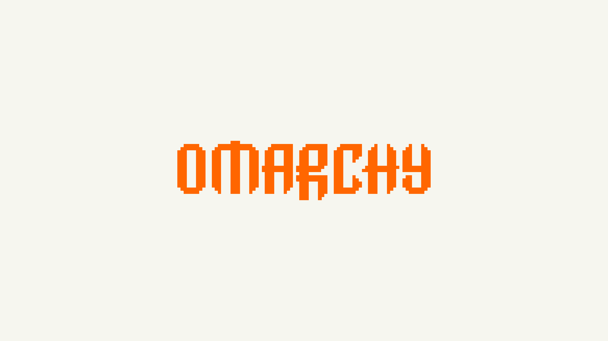

# Hacker News for Omarchy

A light, flat Omarchy theme inspired by [Hacker News](https://news.ycombinator.com/): warm paper, an orange masthead, black headlines, and grey secondary text.



*Wallpaper preview, not a desktop screenshot. Resolution: 3840 × 2160.*

## Palette

| Role | Color |
| --- | --- |
| HN page background | `#F6F6EF` |
| HN header / desktop accent | `#FF6600` |
| Primary text | `#333333` |
| Secondary / visited text | `#828282` |
| Text selection background | `#DEDED8` |
| Recessed surface | `#EBEBE2` |
| Deeper surface | `#DADAD0` |

The orange and paper background are taken from the HN homepage HTML. Secondary text uses HN's visited-link grey, `#828282`. Other surfaces are adaptations, not an official Hacker News palette.

ANSI red, yellow, magenta, and their bright variants use HN orange (`#FF6600`); all other ANSI slots use neutral greys or the paper background. The separate `orange` token remains available to applications that use it explicitly. The original orange has lower contrast for small text on paper; this is a deliberate fidelity tradeoff. ANSI slot names remain unchanged, but status categories no longer have distinct hues; rely on text and symbols to distinguish them.

The shell uses an opaque orange bar with dark-grey text, paper-colored panels, and orange selections with dark-grey text. Terminal text selection uses a light-grey background. Foreground and bright foreground avoid pure black, including when terminal applications use them as inverse-selection backgrounds. No global fonts, GTK settings, or Hyprland rules are changed. Application configurations are generated by Omarchy from `colors.toml`.

## Install

Requires a recent Omarchy version using `colors.toml` and Omarchy Shell.

```sh
omarchy theme install https://github.com/xvvhang/omarchy-hacker-news-theme
```

Back up an existing `~/.config/omarchy/themes/hacker-news/` before installing;
the installer may replace it.

## Use

```sh
omarchy theme set hacker-news
```

Keep the current wallpaper:

```sh
OMARCHY_THEME_SKIP_BACKGROUND=1 omarchy theme set hacker-news
```

## Browser and icons

`chromium.theme` supplies a white (`#FFFFFF`) browser seed color, avoiding the
yellow cast observed with the paper background as the seed. Chromium generates
its own interface palette, so the displayed colors are not guaranteed to match
the seed exactly. It does not recolor web pages.

`icons.theme` selects the default orange `Yaru` icon theme, which must already
be installed on your system. Icon assets are not bundled.

## Attribution

Inspired by Hacker News, operated by Y Combinator. Wallpaper recolored from Omarchy's bundled Gruvbox `backgrounds/omarchy.png`, retaining its centered pixel wordmark. No font software is bundled.

An independent, unofficial theme, not affiliated with or endorsed by Hacker News, Y Combinator, or Omarchy.

By [Alec Xu / @xvvhang](https://github.com/xvvhang).
